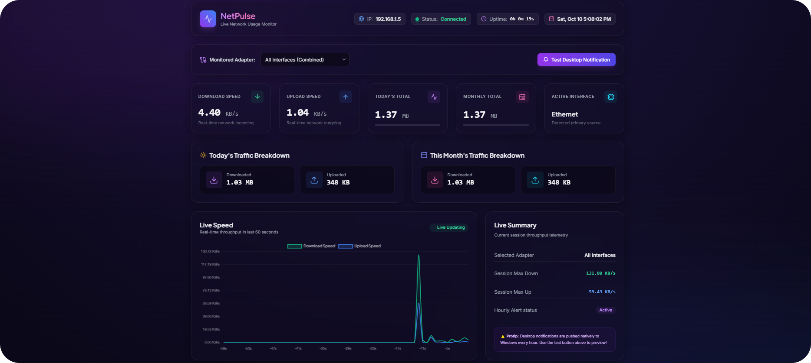

# ⚡ NetPulse — Internet Usage Monitor

<p align="center">
  <strong>Monitor your network. Understand your usage.</strong>
</p>

<p align="center">
  A lightweight network monitoring dashboard built with Python and modern web technologies.
</p>

<p align="center">
  
</p>

---

## 🌐 About NetPulse

**NetPulse** is a desktop-oriented internet usage monitoring application designed to help users understand their network activity through a clean, intuitive dashboard.

It provides real-time download and upload statistics, tracks daily and monthly data consumption, stores historical usage locally, and delivers desktop notifications to keep users informed about their internet activity.

Whether you want to monitor your connection, analyze your data consumption, or keep track of your daily network usage, NetPulse brings essential network statistics together in one place.

## ✨ Features

- 📡 **Real-Time Network Monitoring** — Track download and upload speeds.
- 📊 **Usage Analytics** — Review daily and monthly data consumption.
- 🕒 **Historical Statistics** — Explore hourly and daily network usage.
- 🔔 **Desktop Notifications** — Receive periodic summaries of network activity.
- 🖥️ **Network Interface Selection** — Choose a network adapter to monitor.
- 💾 **Local Data Storage** — Save usage statistics using SQLite.
- 🔒 **Local-First Design** — No cloud database or user account required for local monitoring.
- 🌐 **Web-Based Dashboard** — View network statistics through your browser.

## 🛠️ Built With

| Technology | Purpose |
|---|---|
| Python | Core application logic |
| Flask | Local web server and API |
| psutil | System and network statistics |
| SQLite | Local data storage |
| Plyer | Desktop notifications |
| React | Frontend interface |
| TypeScript | Frontend development |
| Vite | Frontend development and build tooling |

## 📁 Project Structure

```text
NetPulse/
├── app.py
├── database.py
├── monitor.py
├── notification.py
├── requirements.txt
├── package.json
├── package-lock.json
├── index.html
├── templates/
│   └── index.html
├── static/
│   ├── app.js
│   └── style.css
├── src/
│   ├── App.tsx
│   ├── main.tsx
│   ├── index.css
│   └── utils/
├── vite.config.ts
└── tsconfig.json
```

## 🚀 Getting Started

Follow the steps below to run NetPulse on your computer.

### 📋 Prerequisites

- Python 3.10 or newer
- pip
- Git (optional if downloading the repository as a ZIP file)
- Node.js and npm, if building the React frontend separately

### 1. Clone the Repository

Replace the example URL with your actual GitHub repository URL.

```bash
git clone https://github.com/amiraliad06-cpu/NetPulse-Internet-Usage-Monitor
cd NetPulse-Internet-Usage-Monitor
```

Alternatively, download the repository as a ZIP file from GitHub and extract it.

### 2. Create a Virtual Environment

```bash
python -m venv .venv
```

### 3. Activate the Environment

**Windows:**

```bat
.venv\Scripts\activate
```

**Linux / macOS:**

```bash
source .venv/bin/activate
```

### 4. Install Dependencies

```bash
python -m pip install --upgrade pip
python -m pip install -r requirements.txt
```

### 5. Start the Application

```bash
python app.py
```

### 6. Open the Dashboard

Open your browser and visit:

<p align="center">
  <a href="http://127.0.0.1:5000">
    <strong>http://127.0.0.1:5000</strong>
  </a>
</p>

Keep the terminal open while using the application.

## 📊 How It Works

NetPulse collects network traffic statistics from the operating system using Python libraries.

The Flask backend processes monitoring data and provides it to the dashboard through local API endpoints. Usage records are stored in an SQLite database, allowing the application to calculate totals and display historical statistics.

The monitoring process runs in the background while the application is active.

## 💾 Data Storage

NetPulse stores usage records locally in an SQLite database.

The database is created automatically when the application initializes and is stored at:

```text
data/usage.db
```

No cloud database or online account is required for the local monitoring workflow.

**Note:** Usage history depends on the application's collection process. Data may not represent network traffic that occurred before monitoring began or while the application was not running.

## 🔐 Privacy

NetPulse is designed primarily for local use.

- Usage statistics are stored on the local computer.
- No cloud account is required for the core monitoring workflow.
- Network information is collected from operating system interfaces.
- Local traffic statistics may differ from those reported by an internet service provider.

Avoid exposing personal network information or database files when sharing screenshots or publishing project files.

## ⚠️ Limitations

- Monitoring accuracy depends on operating system network counters.
- The application does not inherently identify the traffic usage of every individual program.
- The local server must remain running for live monitoring.
- Desktop notifications depend on operating system permissions and library support.
- Historical statistics are limited to the data collected and saved by the application.
- The React frontend and Flask dashboard are both present in the source tree; the intended production frontend and build workflow should be verified for each release.

## 🗺️ Roadmap

Potential future improvements:

- [ ] Export usage reports to CSV
- [ ] Configurable data usage limits
- [ ] Custom notification thresholds
- [ ] Improved network adapter detection
- [ ] Application-level traffic analysis
- [ ] Enhanced dashboard visualizations
- [ ] Standalone desktop installer
- [ ] Additional language support
- [ ] Improved startup and background monitoring options

## 🤝 Contributing

Contributions, suggestions, and bug reports are welcome.

If you find a bug or have an idea for improvement, feel free to open an issue or submit a pull request.

When contributing, please keep changes focused, document important behavior, and test the application before submitting your changes.

## 📄 License

No license has been specified yet.

Before distributing the project for reuse, modification, or redistribution, add a suitable open-source license and include the corresponding `LICENSE` file.

## 👨‍💻 Project

**NetPulse — Internet Usage Monitor**

<p align="center">
  <strong>See your network. Track your data. Stay informed.</strong>
</p>

<p align="center">
  Built with Python and modern web technologies.
</p>
